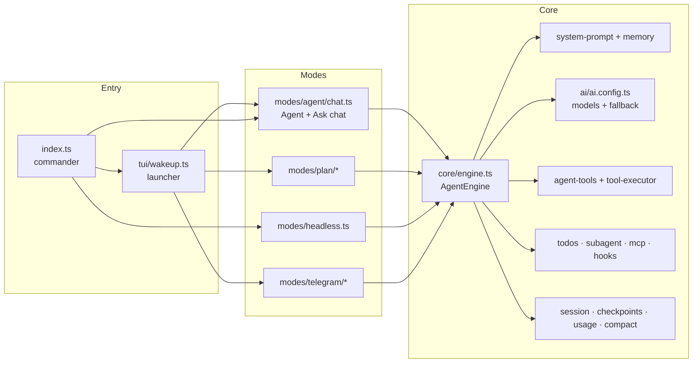

# RushClaw — Feature Guide

This guide lists everything RushClaw can do, how to use each feature, and **where its code lives**, so you can find, change or extend any part of it.

- **Users:** start with [Cheat sheet](#cheat-sheet) and [Modes](#1-modes).
- **Contributors:** jump to [Architecture](#9-architecture) and the *Code* line under each feature.

---

## Contents

1. [Modes](#1-modes): Agent chat · Ask · Plan · Headless · Telegram
2. [Agent tools](#2-agent-tools): what the model can call
3. [Safety and control](#3-safety-and-control): review, hunks, auto-edit, checkpoints, permissions, hooks
4. [Conversation features](#4-conversation-features): streaming, slash commands, sessions, compaction, todos, sub-agents, images, memory
5. [Models and cost](#5-models-and-cost): providers, `/model`, fallback, usage, error messages
6. [Integrations](#6-integrations): MCP servers, git, web research, Telegram extras
7. [Configuration](#7-configuration): `rushclaw.config.json`, `.env`, data folders
8. [Testing](#8-testing)
9. [Architecture](#9-architecture)
10. [Known limitations](#10-known-limitations)

---

## Cheat sheet

```bash
bun install
bun index.ts                        # launcher (CLI / Telegram menu)
bun index.ts chat                   # interactive agent chat in the current folder
bun index.ts chat "fix the failing test"   # start with a first message
bun index.ts chat --auto-edit       # write edits immediately (/undo to revert)
bun index.ts chat --continue        # continue the last conversation
bun index.ts chat --resume          # pick a saved conversation
bun index.ts ask "how does auth work?"     # read-only Q&A
bun index.ts -p "add a --verbose flag" --yes          # headless, applies edits
bun index.ts -p "explain src/app.ts" --output json    # headless, JSON for scripts
bun index.ts undo                   # revert RushClaw's last applied change
bun index.ts sessions               # list saved conversations
bun run test                        # run the test suite
bun run typecheck                   # tsc --noEmit
```

After `bun link`, use `rushclaw-build` instead of `bun index.ts` from any project.

Inside the chat, type `/help` for every slash command (see [4.2](#42-slash-commands)).

---

## 1. Modes

### 1.1 Agent chat (the main mode)

An interactive, multi-turn coding agent in your terminal. You describe a task, and it explores the code, edits files, runs checks and summarizes. Follow-ups keep the context ("now add tests for it").

- Answers stream as they are written (rendered Markdown).
- Each tool call is shown as one line, e.g. `⏺ Edit src/app.ts` → `⎿ Edited src/app.ts: replaced 1 occurrence…`.
- In review mode (default), all changes are shown as diffs after each turn for you to approve. See [3.1](#31-review-mode-staged-changes).
- **Ctrl+C** interrupts a running turn; **Ctrl+C** at the prompt leaves the chat.
- End a line with `\` to type a multi-line message.

**Use:** `rushclaw-build chat`, or Launcher → CLI → *Agent Mode*.

**Code:**
- [modes/agent/chat.ts](modes/agent/chat.ts): the REPL loop (`runChat`), input handling, Ctrl+C, end-of-turn review (`reviewStagedChanges`), session resume, MCP status.
- [core/engine.ts](core/engine.ts): `AgentEngine`, the conversation brain shared by every mode (history, tools, streaming via `runTurn()`, apply/reject, compaction, sessions).
- [modes/agent/orchestrator.ts](modes/agent/orchestrator.ts): `runAgentMode()` entry point.
- [tui/chat-ui.ts](tui/chat-ui.ts): terminal rendering of engine events (`CliUI`) and mid-turn permission prompts (`CliApprover`).

### 1.2 Ask mode (read-only)

The same chat with **only read tools**: grep, read, list, search, sub-agents and web. Use it to understand a codebase safely. Follow-up questions keep context; `/save` exports the conversation to Markdown.

**Use:** `rushclaw-build ask "question"` or Launcher → CLI → *Ask Mode*.

**Code:** [modes/ask/orchestrator.ts](modes/ask/orchestrator.ts) (calls `runChat({ mode: "ask" })`). The read-only tool set is `createReadOnlyTools()` in [modes/agent/agent-tools.ts](modes/agent/agent-tools.ts), and the Ask prompt is `ASK_CORE` in [core/system-prompt.ts](core/system-prompt.ts).

### 1.3 Plan mode

1. The planner researches the codebase (and the web, if Firecrawl is configured).
2. It drafts a 1–15 step plan with a complexity rating per step.
3. You tick the steps to run.
4. The steps run **in one conversation**, so later steps know what earlier ones did.
5. You review all the diffs at the end. The session can be continued in chat (`--resume <id>`).

**Use:** Launcher → CLI → *Plan Mode*, or `/plan` in Telegram.

**Code:**
- [modes/plan/planner.ts](modes/plan/planner.ts): `generatePlan()` (structured JSON output with a zod schema)
- [modes/plan/selection.ts](modes/plan/selection.ts): plan printing and step multi-select
- [modes/plan/orchestrator.ts](modes/plan/orchestrator.ts): step execution through `AgentEngine` (`stepPrompt()`)

### 1.4 Headless mode (scripts and CI)

Runs one non-interactive turn. The answer streams to **stdout** and tool activity to **stderr**, so output can be piped.

| Flag | Meaning |
|---|---|
| `-p, --print <prompt>` | The task. `-p -` reads the prompt from stdin. |
| `-y, --yes` | Apply edits (auto-edit + checkpoint). **Without it nothing is written**: the proposed diffs are printed instead. |
| `-o, --output json` | Print one JSON object: `result`, `error`, `applied`, `staged` (with diffs), `queuedCommands`, `usage`, `costUsd`, `sessionId`. |
| `-m, --model <spec>` | Model for this run. |
| `--max-steps <n>` | Limit the tool loop. |
| `-c, --continue` | Continue the last conversation. |
| `--read-only` | Ask-mode tools only. |
| `--stdin` | Append piped stdin to the prompt, e.g. `cat error.log \| rushclaw-build -p "explain" --stdin`. |

Exit code is `1` when the model call fails. Commands outside the allowlist are never run in headless mode; they are reported instead.

**Code:** [modes/headless.ts](modes/headless.ts) (`runHeadless`). CLI flags are defined in [index.ts](index.ts).

### 1.5 Telegram bot

Remote control from your phone. Only `TELEGRAM_OWNER_ID` can use it.

| Command | What it does |
|---|---|
| `/ask <question>` | Read-only research; the answer is sent as Markdown. |
| `/agent <task>` | Runs the agent, then shows staged changes (with +/- counts) and **Show Diff / Accept All / Reject All** buttons. |
| `/plan <goal>` | Plan with toggle buttons per step, then **Proceed**. |
| `/undo` | Shows the last checkpoint with **Undo / Cancel** buttons. |
| 🎙 *voice note* | Transcribed with Gemini, then **Ask / Agent / Plan / Cancel** buttons. |

- **Live progress:** one message is edited in place, showing tool calls, todo progress and sub-agent steps.
- **Completion alert:** tasks longer than 20 s end with a new message, so your phone notifies you.

**Code:**
- [modes/telegram/handlers.ts](modes/telegram/handlers.ts): all commands, buttons, voice and undo
- [modes/telegram/agent-run.ts](modes/telegram/agent-run.ts): ask / agent / plan runs on `AgentEngine`
- [modes/telegram/progress.ts](modes/telegram/progress.ts): `TelegramProgress` (throttled in-place message edits)
- [modes/telegram/voice.ts](modes/telegram/voice.ts): `transcribeAudio()` (Gemini audio input)
- [modes/telegram/approval-session.ts](modes/telegram/approval-session.ts): diff summary and Accept/Reject (`acceptSession`)
- [modes/telegram/plan-session.ts](modes/telegram/plan-session.ts), [auth.ts](modes/telegram/auth.ts), [index.ts](modes/telegram/index.ts), [constants.ts](modes/telegram/constants.ts), [text.ts](modes/telegram/text.ts)

---

## 2. Agent tools

These are the functions the model can call. Every read tool sees **staged** (not yet applied) edits, so the agent never works from stale files.

| Tool | What it does | Modes | Code |
|---|---|---|---|
| `read_file` | Read a file; `offset`/`limit` page through large files. | all | `ToolExecutor.readFile` |
| `list_files` | List a folder (staged new files are marked). | all | `ToolExecutor.listFiles` |
| `search_files` | Find files by glob (`src/**/*.ts`). | all | `ToolExecutor.searchFiles` |
| `grep` | Regex search inside files → `path:line: text`, with context lines, glob filter, files-only. | all | `ToolExecutor.grep` |
| `analyze_codebase` | File counts, size, extensions. | all | `ToolExecutor.analyzeCodebase` |
| `list_skills` / `read_skill` | Read `SKILL.md` files from `~/.claude/skills`, `~/.cursor/skills-cursor` or `SKILLS_DIRS`. | all | `ToolExecutor.listSkills/readSkill` |
| `edit_file` | **Exact string replacement.** `old_string` must be unique (or use `replace_all`); tolerates CRLF files; `$` in the replacement is literal. | agent | `ToolExecutor.editFile` |
| `create_file` | New file (fails if it exists). | agent | `ToolExecutor.createFile` |
| `modify_file` | Full rewrite (only for big rewrites). | agent | `ToolExecutor.modifyFile` |
| `delete_file` / `create_folder` | Delete a file / `mkdir -p`. | agent | `ToolExecutor.deleteFile/createFolder` |
| `run_command` | Runs a shell command **now** and returns exit code + output (head and tail kept), so the agent can run tests and fix failures. See [3.5](#35-command-permissions). | agent | `createRunCommandTool` |
| `todo_write` | Maintains a visible checklist. See [4.5](#45-todo-list). | agent | [core/todos.ts](core/todos.ts) |
| `task` | Delegates research to a read-only sub-agent. See [4.6](#46-sub-agents). | agent, ask | [core/subagent.ts](core/subagent.ts) |
| `web_search` / `web_crawl` / `fetch_url` | Web research (Firecrawl key needed for search/crawl). | all | [modes/plan/web-tools.ts](modes/plan/web-tools.ts) |
| `mcp__<server>__<tool>` | Tools from your MCP servers. See [6.1](#61-mcp-servers). | agent | [core/mcp.ts](core/mcp.ts) |

**Code:**
- Tool definitions: [modes/agent/agent-tools.ts](modes/agent/agent-tools.ts) (`createReadOnlyTools`, `createAgentTools`, `createRunCommandTool`)
- Implementations: [modes/agent/tool-executor.ts](modes/agent/tool-executor.ts) (`ToolExecutor`)
- Assembly per mode: `AgentEngine.tools()` in [core/engine.ts](core/engine.ts)
- Tool-call display: [tui/tool-display.ts](tui/tool-display.ts)

---

## 3. Safety and control

### 3.1 Review mode (staged changes)

By default (`permissionMode: "review"`), edits are **staged in memory**, not written to disk. At the end of each turn you see a summary (`edit src/a.ts +3 -1`) and choose one of:

- **Approve and apply all**
- **Review one by one**: Accept / Show diff / **Pick hunks** / Reject, per file
- **Show all diffs** (colored)
- **Reject all**

The model is told what you applied or rejected, so the next turn knows the real state of the files.

**Code:**
- [modes/agent/approval.ts](modes/agent/approval.ts): `runApprovalFlow`, `groupPending`
- [modes/agent/diff-view.ts](modes/agent/diff-view.ts): diffs, colors, +/- stats
- [modes/agent/action-tracker.ts](modes/agent/action-tracker.ts): the log of staged actions
- `AgentEngine.applyApproved()` / `rejectAll()` in [core/engine.ts](core/engine.ts)

### 3.2 Per-hunk approval

For an edited file with several separate changes, **Pick hunks** walks through each change block: Keep / Skip / Keep all remaining / Skip all remaining. Only the kept hunks are written.

**Code:** `pickHunks()` in [modes/agent/approval.ts](modes/agent/approval.ts); `fileHunks()` and `applySelectedHunks()` in [modes/agent/diff-view.ts](modes/agent/diff-view.ts).

### 3.3 Auto-edit mode

`/mode auto-edit`, `chat --auto-edit` or `"permissionMode": "auto-edit"` writes edits to disk **immediately**, so `run_command` (tests, type-check) sees them during the same turn. Every turn is one checkpoint, so `/undo` reverts the whole turn.

**Code:** `ToolExecutor.afterStage()` / `takeAutoApplied()` in [tool-executor.ts](modes/agent/tool-executor.ts); `AgentEngine.setPermissionMode()` in [core/engine.ts](core/engine.ts).

### 3.4 Checkpoints and undo

Before any file is written or deleted, by approval, auto-edit, Telegram Accept or headless `--yes`, its original content is saved to `~/.rushclaw/projects/<project>/checkpoints/` (the last 50 are kept).

- `/undo` (chat), `rushclaw-build undo [-y]` (CLI) or `/undo` (Telegram) restores modified files and **deletes files the agent created**.
- `/undo list` shows the recent checkpoints.
- The model is told when you undo its change.

**Code:** [core/checkpoints.ts](core/checkpoints.ts) (`CheckpointStore`, `CheckpointBuilder`); `AgentEngine.undo()`; the `undo` command in [index.ts](index.ts).

### 3.5 Command permissions

`run_command` decides what to do with each command:

1. **Allowlisted** commands run without asking: tests, type-checks, linters, builds, `git status/diff/log/show`, `ls`… The default list is `DEFAULT_ALLOWED_COMMANDS` in [core/config.ts](core/config.ts); override it with `allowedCommands`.
2. A command containing **shell operators** (`; | & > < $ \` ( )`) or `--output` is **never** auto-allowed, so `git status; rm -rf .` can't sneak through.
3. Anything else **asks you mid-turn**: *Yes* / *Yes, and don't ask again for `npm run …` this session* / *No*.
4. Where nobody can be asked (Telegram, headless), the command is **queued** and runs only if you approve it with the turn's changes. In headless mode it is reported, never run.

MCP tool calls use the same prompt (see [6.1](#61-mcp-servers)).

**Code:** [core/permissions.ts](core/permissions.ts) (`PermissionGate`, `isCommandAllowed`, `commandFamily`), `createRunCommandTool` in [agent-tools.ts](modes/agent/agent-tools.ts), [core/shell.ts](core/shell.ts) (async runner with timeout and abort), and `CliApprover` in [tui/chat-ui.ts](tui/chat-ui.ts).

### 3.6 Built-in protections

- **Workspace jail:** paths outside the project root are rejected (`resolveSafe`).
- **Secrets:** `.env*` files are always excluded from reads, search, grep and listing, even if you change `excludePatterns`.
- **Excludes:** `node_modules`, `.git`, `dist`, `build`, `.next`, `*.log` by default (`excludePatterns`).

**Code:** `resolveSafe`, `excluded`, `keyOf` in [tool-executor.ts](modes/agent/tool-executor.ts); `defaultAgentConfig` in [modes/agent/types.ts](modes/agent/types.ts).

### 3.7 Hooks

Shell commands that run around tool calls. Configure them in `hooks` (see [rushclaw.config.example.json](rushclaw.config.example.json)).

| Event | When | Special behavior |
|---|---|---|
| `preToolUse` | Before a tool runs (regex `matcher` on the tool name) | **Exit code 2 blocks the call**; the hook's output is given to the model as the reason. |
| `postToolUse` | After a tool runs | A **non-zero exit** (e.g. a linter) is appended to the tool result so the model can fix it. |
| `postApply` | After changes are written to disk | e.g. `bunx prettier --write $RUSHCLAW_CHANGED_FILES`; failures are reported to you and the model. |

Hooks receive the event as **JSON on stdin**, plus these environment variables: `RUSHCLAW_EVENT`, `RUSHCLAW_TOOL_NAME`, `RUSHCLAW_TOOL_INPUT`, `RUSHCLAW_FILE_PATH` and `RUSHCLAW_CHANGED_FILES`. These `$RUSHCLAW_*` variables are also expanded inside the command itself, so the same hook works in `cmd.exe` and `sh`. `/hooks` lists them.

**Code:** [core/hooks.ts](core/hooks.ts) (`runHooks`, `wrapToolsWithHooks`, `expandHookCommand`); `AgentEngine.runPostApplyHooks()`.

---

## 4. Conversation features

### 4.1 Streaming output

Text is rendered as Markdown **block by block** while the model writes. It is flushed at blank lines and never split inside a code fence. A spinner shows what is happening (`Thinking…`, `Grep /x/…`, elapsed seconds) and clears itself before any output.

**Code:** [tui/stream-md.ts](tui/stream-md.ts) (`StreamingMarkdown`), [tui/activity.ts](tui/activity.ts) (`Activity` spinner), [tui/terminal-md.ts](tui/terminal-md.ts); the stream loop is in `AgentEngine.runTurn()`.

### 4.2 Slash commands

| Command | What it does | Code |
|---|---|---|
| `/help` | List commands and tips. | [slash-commands.ts](modes/agent/slash-commands.ts) |
| `/clear` (`/new`) | New conversation (clears history and staged changes). | 〃 |
| `/model [spec]` | Show or switch the model (picker when no argument). | 〃 |
| `/mode [review\|auto-edit]` | Switch the permission mode. | 〃 |
| `/cost` | Token usage per model and estimated cost. | 〃 + [core/usage.ts](core/usage.ts) |
| `/compact [focus]` | Summarize the conversation to free context. | 〃 + [core/compact.ts](core/compact.ts) |
| `/resume` (`/sessions`) | Switch to a saved conversation. | 〃 + [core/session.ts](core/session.ts) |
| `/todos` | Show the agent's checklist. | 〃 |
| `/undo [list]` | Revert the last applied change / list checkpoints. | 〃 + [core/checkpoints.ts](core/checkpoints.ts) |
| `/init` | Generate `RUSHCLAW.md` project memory. | 〃 + [core/memory.ts](core/memory.ts) |
| `/memory [reload]` | Show / re-read the loaded memory files. | 〃 |
| `/config` | Config file locations and effective settings. | 〃 |
| `/mcp [reconnect]` | MCP servers and their tools. | 〃 + [core/mcp.ts](core/mcp.ts) |
| `/hooks` | Configured hooks. | 〃 |
| `/save [file.md]` | Export the conversation as Markdown. | 〃 |
| `/diff [--stat]` | Colored `git diff HEAD`. | [git-commands.ts](modes/agent/git-commands.ts) |
| `/commit` | AI-written commit message; you pick the files and confirm. | 〃 + [core/git.ts](core/git.ts) |
| `/review [base]` | AI code review of uncommitted changes, or of the branch vs base. | 〃 |
| `/pr [base]` | Push and open a GitHub PR with an AI title/body (needs `gh`). | 〃 |
| `/exit` (`/quit`) | Leave the chat. | 〃 |

**Adding your own:** call `registerSlash({ name, description, run })` from [modes/agent/slash-commands.ts](modes/agent/slash-commands.ts). [git-commands.ts](modes/agent/git-commands.ts) is a complete example.

### 4.3 Sessions and resume

Every chat, Ask, Plan and headless turn is saved to `~/.rushclaw/projects/<project>/sessions/<id>.json`. Each file holds the messages, todos, usage, model and mode.

**Resume with:** `chat --continue`, `chat --resume [id]`, `ask --continue`, `-p … --continue`, `/resume`, or list them with `rushclaw-build sessions`.

**Code:** [core/session.ts](core/session.ts) (`SessionStore`); `AgentEngine.save()`, `toSession()`, `loadSession()`; `pickSession()` and `printResumed()` in [chat.ts](modes/agent/chat.ts).

### 4.4 Context compaction

Long conversations are summarized into a structured brief: goal, work done, code facts, current state and next steps. Then the work continues with a small context.

- **Automatic:** before a turn, once the context passes `compactAtTokens` (default 120k).
- **Manual:** `/compact [what to focus on]`.

The summary is built from a text transcript with truncated tool output, so it works even when the raw history is huge.

**Code:** [core/compact.ts](core/compact.ts) (`transcriptOf`, `summarizeConversation`, `compactedHistory`); `AgentEngine.compact()` and `maybeAutoCompact()`.

### 4.5 Todo list

For multi-step work the agent writes a checklist with `todo_write`. It is printed whenever it changes (☐ pending, ◐ in progress, ☒ done), shown live in Telegram, included in compaction summaries, and available any time with `/todos`.

**Code:** [core/todos.ts](core/todos.ts) (`createTodoTool`, `formatTodos`); the `todos` callback in [tui/chat-ui.ts](tui/chat-ui.ts).

### 4.6 Sub-agents

The `task` tool lets the main agent hand off a research question ("find every place tokens are validated"). The question goes to a **read-only sub-agent** with its own tool loop. Only the sub-agent's final report enters the main conversation, which keeps the main context small. Sub-agent steps appear nested (`⎿ ↳ Grep /token/`), and their tokens count toward `/cost`.

**Code:** [core/subagent.ts](core/subagent.ts) (`createTaskTool`); the sub-agent prompt is `SUBAGENT_CORE` in [core/system-prompt.ts](core/system-prompt.ts).

### 4.7 Image input

Put images in a message as `@screenshots/bug.png`, as a `"quoted path.jpg"`, or by dragging a file into the terminal. PNG, JPG, GIF and WebP up to 10 MB are supported. They are sent to the model as image parts; the text shows `[image: bug.png]`. Missing `@` references are reported. Works in chat and headless (`-p "what's wrong in @shot.png"`).

**Code:** [core/images.ts](core/images.ts) (`extractImageRefs`, `buildUserContent`); the `prepareInput` hook in [chat.ts](modes/agent/chat.ts).

### 4.8 Project memory (`RUSHCLAW.md`) and `/init`

Instructions loaded into **every** prompt:

- `~/.rushclaw/RUSHCLAW.md`: your personal rules, for all projects.
- `<project>/RUSHCLAW.md`: project conventions, commands and gotchas. If it doesn't exist, `CLAUDE.md` or `AGENTS.md` is read instead.

`/init` has the agent study the repo and write `RUSHCLAW.md` for you, which you then approve like any other change. `/memory` shows what is loaded.

**Code:** [core/memory.ts](core/memory.ts) (`loadMemory`, `INIT_PROMPT`); prompt assembly in [core/system-prompt.ts](core/system-prompt.ts).

### 4.9 System prompt

Each mode has its own instructions:

- **Agent:** explore before editing, small exact edits, verify with tests, match the code style, no secrets, no destructive commands, finish with a summary.
- **Ask:** cite `path:line` and don't guess.
- **Plan / sub-agent:** compact factual reports.

Every prompt also includes the environment (root, OS/shell, date, git branch). Tool-specific guidance appears only when that tool is available.

**Code:** [core/system-prompt.ts](core/system-prompt.ts) (`buildSystemPrompt`).

---

## 5. Models and cost

### 5.1 Providers and model specs

- **Gemini** (Google AI Studio, generous free tier) and **OpenRouter** are supported.
- Models are written as `gemini:<id>` or `openrouter:<id>`. A bare id containing `/` means OpenRouter.
- Pick the model with the `model` config key, the `-m/--model` flag, `/model` in the chat, or the env vars `GEMINI_MODEL` / `OPENROUTER_DEFAULT_MODEL`.

**Code:** [ai/ai.config.ts](ai/ai.config.ts) (`parseModelSpec`, `defaultModelSpec`, `createBaseModel`, `getAgentModel`).

### 5.2 Automatic fallback

With `"fallbackModels": ["openrouter:openrouter/auto"]`, a **rate limit / quota / overload** error retries the same request on the next model, and you see a notice. The limited model is then skipped for 60 s, so later steps don't hit the same 429.

**Code:** `withFallback()` in [ai/ai.config.ts](ai/ai.config.ts) (a language-model middleware), `isRateLimitError()`.

### 5.3 Token usage and cost

- After every turn: `↳ 11k in · 113 out · 4 call(s) · context 2.9k`.
- `/cost` shows totals per model.
- Add a `pricing` table (USD per 1M tokens) to get a cost estimate. The Gemini free tier costs $0.

**Code:** [core/usage.ts](core/usage.ts) (`UsageTracker`).

### 5.4 Clear error messages

Errors name the provider actually in use, with concrete fixes:

- Gemini quota vs the OpenRouter free-tier limit
- Missing or invalid API key
- Unknown model id

**Code:** [core/errors.ts](core/errors.ts) (`describeError`, `printError`, `errorText`).

---

## 6. Integrations

### 6.1 MCP servers

Connect any [Model Context Protocol](https://modelcontextprotocol.io) server. Local servers run as a command over stdio; remote ones use an `http`/`sse` URL with headers.

```json
"mcpServers": {
  "docs": { "command": "npx", "args": ["-y", "@modelcontextprotocol/server-filesystem", "./docs"] },
  "remote": { "type": "http", "url": "https://example.com/mcp", "headers": { "Authorization": "Bearer …" } }
}
```

Their tools appear as `mcp__<server>__<tool>`. Every call asks for permission (yes / always / no) unless `"autoApproveMcpTools": true`. A server that fails to connect is reported and skipped. `/mcp` lists servers and tools.

**Code:** [core/mcp.ts](core/mcp.ts) (`McpManager`, `mcpToolName`), using `@ai-sdk/mcp`; `AgentEngine.connectMcp()` / `close()`.

### 6.2 Git

- **`/commit`:** pick files (untracked files start unselected). The model writes a message in the style of your recent commits. Then Commit / Edit subject / Regenerate / Cancel.
- **`/review`:** reviews bugs, security, tests and readability, most important first.
- **`/pr`:** pushes the branch, writes the title and body, and runs `gh pr create`. If `gh` is missing, it explains how to install it.
- **`/diff`:** colored diff vs `HEAD`.

**Code:** [core/git.ts](core/git.ts) (git helpers and AI prompts) and [modes/agent/git-commands.ts](modes/agent/git-commands.ts) (slash commands).

### 6.3 Web research

`web_search` and `web_crawl` (Firecrawl, needs `FIRECRAWL_API_KEY`) and `fetch_url` (plain HTTP GET) are available in Agent, Ask, Plan and sub-agents.

**Code:** [modes/plan/web-tools.ts](modes/plan/web-tools.ts).

---

## 7. Configuration

### 7.1 `rushclaw.config.json`

Optional. RushClaw reads `~/.rushclaw/config.json` (user) and then `<project>/rushclaw.config.json` (project) on top. Copy [rushclaw.config.example.json](rushclaw.config.example.json) to start.

| Key | Default | Meaning |
|---|---|---|
| `model` | from `.env` | `gemini:<id>` / `openrouter:<id>` |
| `fallbackModels` | `[]` | Models to try on rate limits |
| `permissionMode` | `"review"` | `review` or `auto-edit` |
| `maxSteps` / `subagentMaxSteps` | `40` / `25` | Tool-loop limits |
| `compactAtTokens` | `120000` | Auto-compaction threshold (`0` = off) |
| `allowedCommands` | tests, builds, git read-only… | Command prefixes `run_command` may run without asking |
| `commandTimeoutMs` | `120000` | Per-command timeout |
| `excludePatterns` | `node_modules`, `.git`, `dist`… | Hidden from the agent (`.env*` always) |
| `hooks` | `{}` | `preToolUse` / `postToolUse` / `postApply` |
| `mcpServers` | `{}` | MCP servers |
| `autoApproveMcpTools` | `false` | Skip the MCP permission prompt |
| `pricing` | `{}` | `{ "<model-id>": { "input": $/1M, "output": $/1M } }` |

**Code:** [core/config.ts](core/config.ts) (`loadConfig`, `mergeConfig`, defaults). `hooks`, `mcpServers` and `pricing` merge key by key; other keys replace.

### 7.2 Environment variables (`.env`)

`GEMINI_API_KEY`, `GEMINI_MODEL`, `OPENROUTER_API_KEY`, `OPENROUTER_DEFAULT_MODEL`, `FIRECRAWL_API_KEY`, `TELEGRAM_BOT_TOKEN`, `TELEGRAM_OWNER_ID`, and optionally `SKILLS_DIRS` and `RUSHCLAW_HOME`.

Besides the `.env` in the current folder, RushClaw also reads `~/.rushclaw/.env` and the `.env` next to its own install. That way the globally linked CLI finds your keys inside any project. Existing variables are never overridden.

**Code:** [core/env.ts](core/env.ts) (`loadExtraEnv`), called at the top of [index.ts](index.ts).

### 7.3 Where RushClaw stores data

```text
~/.rushclaw/                      (override with RUSHCLAW_HOME)
├── config.json                   user config
├── RUSHCLAW.md                   user memory
├── .env                          optional global API keys
└── projects/<project-path-slug>/
    ├── sessions/<id>.json        saved conversations
    └── checkpoints/<id>.json     file snapshots for /undo (last 50)
```

Nothing is written inside your project except the changes you approve, and the files you ask for (`/save`, `RUSHCLAW.md`).

---

## 8. Testing

```bash
bun run test        # 69 tests across 13 files
bun run typecheck
```

| Test file | Covers |
|---|---|
| [tests/tool-executor.test.ts](tests/tool-executor.test.ts) | path jail, `.env` exclusion, `edit_file`, staged-aware reads, grep, paging, apply, globs, allowlist, permission gate, config merge |
| [tests/engine.test.ts](tests/engine.test.ts) | streaming, tool loop, staging, history, rejection notes, Ask tool set, todos, sub-agents |
| [tests/checkpoints.test.ts](tests/checkpoints.test.ts) | restore/delete, auto-edit turn + undo, review apply + undo |
| [tests/diff-view.test.ts](tests/diff-view.test.ts) | hunk selection, line stats |
| [tests/session-compact.test.ts](tests/session-compact.test.ts) | save/resume, transcript, `/compact`, auto-compaction |
| [tests/hooks.test.ts](tests/hooks.test.ts) | matchers, variable expansion, stdin payload, blocking, feedback, postApply |
| [tests/mcp.test.ts](tests/mcp.test.ts) | real stdio MCP server ([fixture](tests/fixtures/echo-mcp-server.cjs)), approval, denial, connect failure |
| [tests/git.test.ts](tests/git.test.ts) | status/diff in a temp repo, commit message and PR parsing |
| [tests/images.test.ts](tests/images.test.ts) | `@image` parsing and content parts |
| [tests/model-fallback.test.ts](tests/model-fallback.test.ts) | spec parsing, fallback chain + cooldown, usage/cost |
| [tests/stream-md.test.ts](tests/stream-md.test.ts) | streaming Markdown boundaries |
| [tests/headless.test.ts](tests/headless.test.ts) | CLI flags, JSON errors, `.env` parsing |
| [tests/telegram.test.ts](tests/telegram.test.ts) | in-place progress message, Accept flow |

The tests use a scripted mock model ([tests/helpers.ts](tests/helpers.ts) → `scriptedModel`) and temporary folders. They never call a real API, and `RUSHCLAW_HOME` is redirected away from your real home folder.

---

## 9. Architecture



**One turn, step by step:**

1. `chat.ts` reads input and attaches `@images` (`prepareInput`).
2. `AgentEngine.runTurn()` auto-compacts if needed, builds the tools (with hooks and MCP) and the system prompt, then calls `ToolLoopAgent.stream()`.
3. The stream emits `text-delta`, `tool-call`, `tool-result` and `finish-step` events. They feed `CliUI` (or `TelegramProgress` / headless writers) and `UsageTracker`.
4. Tools run in `ToolExecutor`. Edits go to the **overlay** (staged), or straight to disk with a checkpoint in auto-edit mode.
5. After the turn: `reviewStagedChanges()` → `runApprovalFlow()` → `applyApproved()` (checkpoint) → `runPostApplyHooks()`. A note is added for the model and the session is saved.

### File map

| Path | Purpose |
|---|---|
| [index.ts](index.ts) | CLI entry: launcher, `chat`, `ask`, `-p` headless, `undo`, `sessions` |
| **ai/** | |
| [ai/ai.config.ts](ai/ai.config.ts) | Providers, model specs, fallback middleware |
| **core/** | Shared, UI-independent logic |
| [core/engine.ts](core/engine.ts) | `AgentEngine`: conversation, streaming turn loop, apply/undo, sessions, compaction, MCP |
| [core/config.ts](core/config.ts) | Config schema, defaults, loading/merging, data folders |
| [core/system-prompt.ts](core/system-prompt.ts) | Mode-specific system prompts |
| [core/memory.ts](core/memory.ts) | `RUSHCLAW.md` loading, `/init` prompt |
| [core/permissions.ts](core/permissions.ts) | Permission gate, command allowlist |
| [core/shell.ts](core/shell.ts) | Async shell runner, output clipping |
| [core/checkpoints.ts](core/checkpoints.ts) | File snapshots and undo |
| [core/session.ts](core/session.ts) | Saved conversations |
| [core/compact.ts](core/compact.ts) | Conversation summarization |
| [core/todos.ts](core/todos.ts) | `todo_write` tool + rendering |
| [core/subagent.ts](core/subagent.ts) | `task` tool (read-only sub-agent) |
| [core/mcp.ts](core/mcp.ts) | MCP client manager |
| [core/hooks.ts](core/hooks.ts) | Hook runner and tool wrapping |
| [core/git.ts](core/git.ts) | Git helpers, commit/review/PR prompts |
| [core/images.ts](core/images.ts) | Image reference parsing |
| [core/usage.ts](core/usage.ts) | Token/cost accounting |
| [core/errors.ts](core/errors.ts) | Provider-aware error messages |
| [core/env.ts](core/env.ts) | Extra `.env` loading |
| **modes/agent/** | |
| [chat.ts](modes/agent/chat.ts) | Interactive REPL |
| [slash-commands.ts](modes/agent/slash-commands.ts) | Slash command registry + built-ins |
| [git-commands.ts](modes/agent/git-commands.ts) | `/diff` `/commit` `/review` `/pr` |
| [agent-tools.ts](modes/agent/agent-tools.ts) | Tool definitions (zod schemas) |
| [tool-executor.ts](modes/agent/tool-executor.ts) | File ops, staging overlay, grep, apply |
| [approval.ts](modes/agent/approval.ts) | Review UI incl. hunk picking |
| [diff-view.ts](modes/agent/diff-view.ts) | Diffs, hunks, stats, colors |
| [action-tracker.ts](modes/agent/action-tracker.ts) / [types.ts](modes/agent/types.ts) | Staged action log, agent config |
| [orchestrator.ts](modes/agent/orchestrator.ts) | `runAgentMode` entry |
| **modes/** (other) | [ask/](modes/ask/orchestrator.ts), [plan/](modes/plan), [telegram/](modes/telegram), [headless.ts](modes/headless.ts), [cli.ts](modes/cli.ts) (sub-mode menu) |
| **tui/** | [chat-ui.ts](tui/chat-ui.ts), [stream-md.ts](tui/stream-md.ts), [activity.ts](tui/activity.ts), [tool-display.ts](tui/tool-display.ts), [terminal-md.ts](tui/terminal-md.ts), [wakeup.ts](tui/wakeup.ts) (banner) |
| **tests/** | See [Testing](#8-testing) |

### Extending RushClaw

- **New tool:** add it to `createAgentTools` (or `createReadOnlyTools`) in [agent-tools.ts](modes/agent/agent-tools.ts), and implement the logic in `ToolExecutor` if it touches files, so staging and checkpoints keep working. Add a label in [tui/tool-display.ts](tui/tool-display.ts).
- **New slash command:** `registerSlash()` (see [4.2](#42-slash-commands)).
- **New front-end** (web, Discord…): create an `AgentEngine` with your own `EngineUI` callbacks and `Approver`, as [modes/telegram/agent-run.ts](modes/telegram/agent-run.ts) and [modes/headless.ts](modes/headless.ts) do.
- **New provider:** extend `createBaseModel()` in [ai/ai.config.ts](ai/ai.config.ts).

---

## 10. Known limitations

- **Review mode and `run_command`:** commands run against files **on disk**, so they don't see staged edits; the agent is told this. Use auto-edit mode when you want the agent to test its own changes during a turn.
- **Undo covers file changes only.** Shell commands the agent ran, and empty folders it created, are not reverted.
- **Commands on Windows** run in `cmd.exe`. Allowlist entries like `ls`/`pwd` only work where those commands exist.
- **`/pr`** needs the GitHub CLI (`gh`). Without it, `/pr` pushes the branch and explains how to install `gh`.
- **Voice notes** need `GEMINI_API_KEY` (Gemini does the transcription), even if your main model is on OpenRouter.
- **MCP tools in Telegram/headless** can't ask for permission, so they are denied unless `"autoApproveMcpTools": true`.
- **Cost estimates** need a `pricing` table; token counts come from the provider and can be approximate for some OpenRouter models.
- **Conversations are per project folder.** `--continue` picks the latest session for the current directory.
