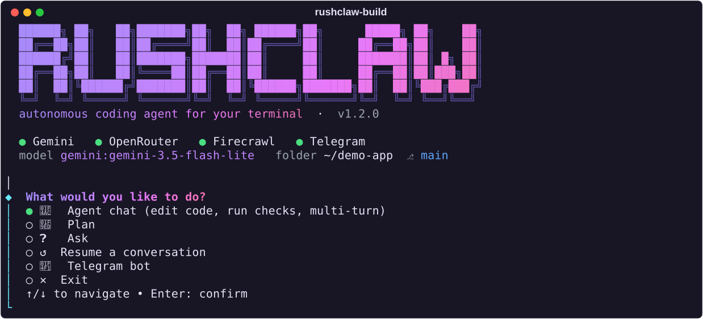
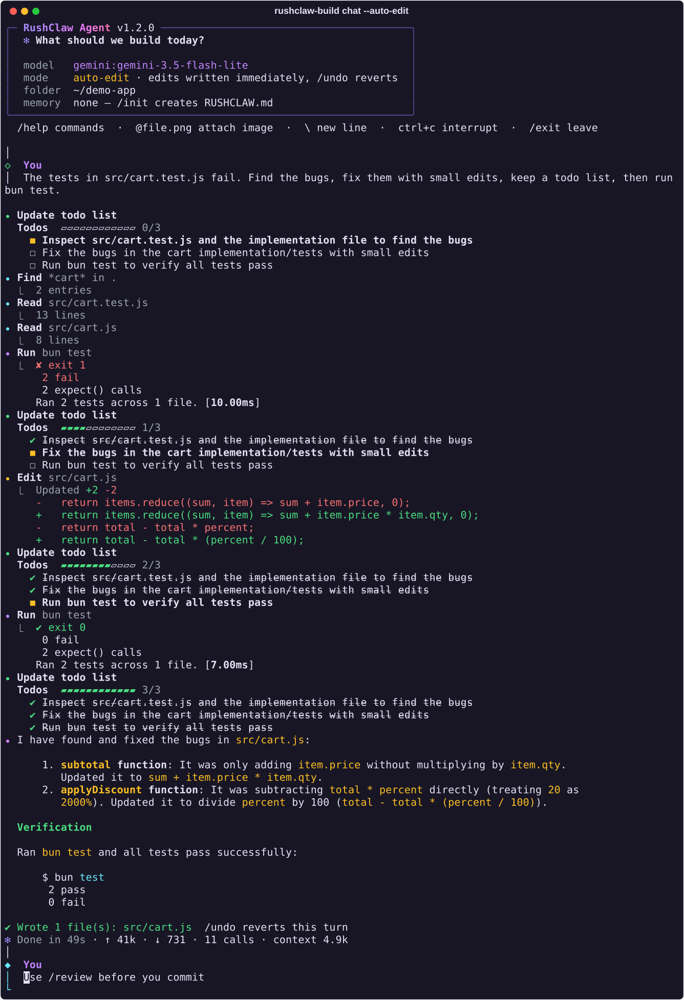
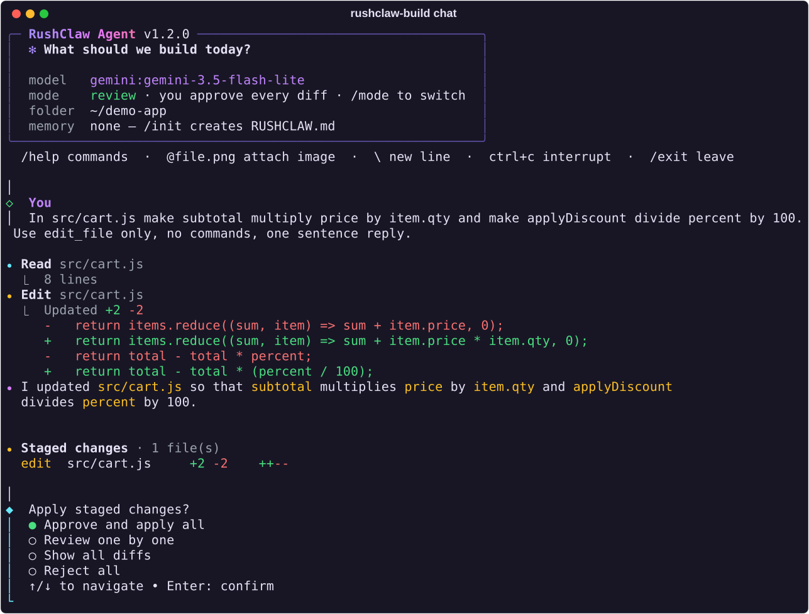
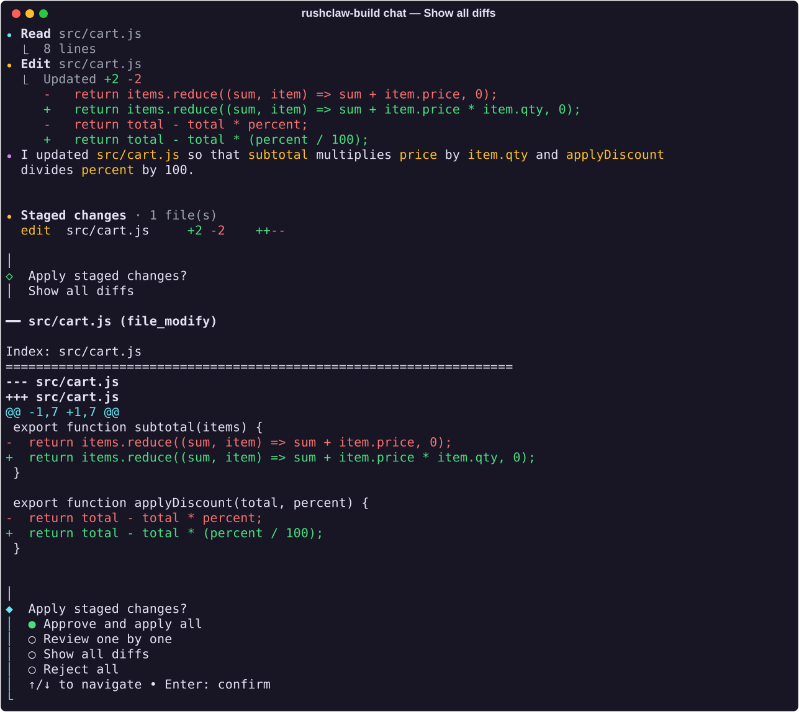
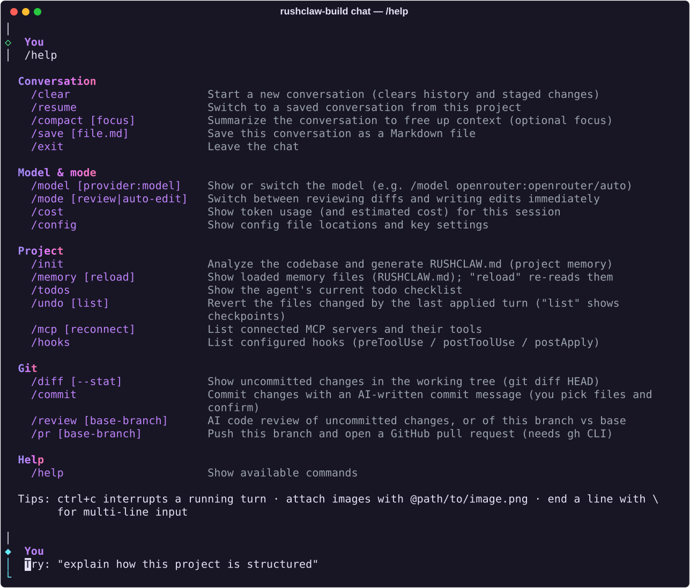

# RushClaw.AI 🦅

<div align="center">

[](https://www.typescriptlang.org/)
[](https://bun.sh/)
[](https://aistudio.google.com/)
[](https://openrouter.ai/)
[](https://sdk.vercel.ai/)
[](https://telegram.org/)

**Autonomous Agentic Coding Assistant & Multi-Mode CLI built with Bun & TypeScript.**  
*Transform natural language prompts into safely staged, approval-gated codebase changes with CLI and Telegram Bot control.*

[Key Features](#-key-features) • [Terminal Output](#-terminal-output--interactive-flow) • [Quickstart](#-quickstart) • [Operating Modes](#-operating-modes) • [Architecture](#-project-architecture)

<br/>

<p align="center">
  
</p>

</div>

---

## ⚡ Overview

**RushClaw.AI** is an intelligent, high-performance developer tool that executes complex software development tasks autonomously while keeping you firmly in control. Built from the ground up using **Bun** and the **Vercel AI SDK**, RushClaw supports **Google Gemini (Google AI Studio)** and **OpenRouter** models, web research via **Firecrawl**, git-style diff previews, and remote operation via a **Telegram Bot**.

Every single codebase mutation (file creation, modification, or directory addition) is staged in-memory, visualized with colored diffs, and requires explicit user approval before touching your disk.

---

## 🚀 Key Features

> 📘 **Full feature guide — what every feature does and where its code lives: [FEATURES.md](./FEATURES.md)**

- 💬 **Interactive Agent Chat** — Multi-turn conversation with streaming Markdown output, live tool activity, Ctrl+C to interrupt, and 20 slash commands (`/model`, `/undo`, `/compact`, `/commit`, `/review`, `/pr`, `/resume`, …).
- ✂️ **Precise Editing & Verification** — `edit_file` exact-replacement edits, regex `grep`, and `run_command` that runs tests/type-checks and feeds the output back so the agent fixes its own mistakes.
- ↩️ **Checkpoints & Undo** — Every applied change is snapshotted; `/undo` (or `rushclaw-build undo`) restores it. Choose `review` mode (approve diffs, even per hunk) or `auto-edit` mode.
- 🧠 **Project Memory & Sessions** — `RUSHCLAW.md` loaded into every prompt (`/init` writes it), conversations saved and resumable (`--continue`, `--resume`), auto-compaction for long sessions.
- 🧩 **Sub-agents, Todos, MCP, Hooks** — Delegate research to read-only sub-agents, visible task checklists, any MCP server's tools, and pre/post tool hooks (e.g. auto-format after edits).
- 🛰️ **Headless Mode** — `rushclaw-build -p "task" --yes --output json` for scripts and CI.
- 🖼️ **Image Input** — Reference screenshots with `@path/to/image.png`.
- 🔁 **Model Fallback & Cost Tracking** — Automatic switch to a backup model on rate limits; per-turn token usage and `/cost`.
- 🤖 **Autonomous Agent Mode** — Loops through multi-step reasoning, file inspection, directory tree analysis, and code synthesis.
- 🧭 **Deep Plan Mode** — Researches your goal, analyzes current skills and dependencies, queries live web sources, drafts a 1–15 step plan, and lets you select which steps to execute.
- ❓ **Interactive Ask Mode** — Deep read-only Q&A about code semantics, architecture, or tech stacks with optional Markdown report exporting.
- 📱 **Telegram Bot Integration** — Run Agent, Plan, and Ask modes remotely via Telegram, with a live progress message, voice-note tasks, completion notifications, `/undo`, and inline buttons for step execution, diff previews, and change approvals.
- 🛡️ **Zero Unapproved Mutations** — Full staging and approval workflow. Inspect visual diffs before applying any changes to your project.
- 🌐 **Web Research & Scraping** — Native web search, URL fetching, and markdown scraping powered by **Firecrawl**.
- 🎨 **Modern Terminal UI** — Retro shadow ANSI banners (via `figlet`), clean interactive prompts (`@clack/prompts`), and full terminal markdown rendering (`marked` + `marked-terminal`).
- ⚡ **Dual AI Engine Support** — Seamlessly runs on **Google Gemini** (1,500 requests/day on Google AI Studio free tier) or **OpenRouter**.

---

## 📸 Terminal Output & Interactive Flow

RushClaw has a colorful, animated terminal interface. These screenshots are real sessions, recorded from the terminal on a small demo project with Gemini:

### 🚀 Launcher

`rushclaw-build` (or `bun index.ts`) opens the animated launcher shown at the top of this page. The logo fills in with the brand gradient, the status line shows which API keys are configured, and every mode is one keypress away.

### 🐛 The agent fixing a bug by itself

In `--auto-edit` mode the agent works through a full loop:
1. Plans with a todo checklist.
2. Reads the code.
3. Runs the tests and sees them fail.
4. Fixes both bugs with one small edit (inline red/green diff).
5. Re-runs the tests and sees them pass.
6. Summarizes what it did.

The footer shows time, tokens and model calls for the turn.

<p align="center">
  
</p>

### ✅ Reviewing changes before they touch your files

In the default `review` mode, edits are staged. You see a change table and decide: approve all, review file by file (or hunk by hunk), show the diffs, or reject.

<p align="center">
  
</p>

<details>
<summary><b>Show all diffs</b> — the full colored diff before approving</summary>
<p align="center">
  
</p>
</details>

### ⌨️ Slash commands

`/help` lists every command, grouped by what it does:

<p align="center">
  
</p>

| UI Element | Description |
| :--- | :--- |
| **Animated Gradient Banner** | The ASCII logo fills in with a violet → pink gradient and a light sweep, then the tagline types out, followed by a status line (configured keys, model, folder, git branch). |
| **One-Step Launcher** | Agent chat, Plan, Ask, Resume a conversation, Telegram bot, all from the first menu, with hints. Leaving a mode returns to the launcher. |
| **Shimmering Spinner** | A playful verb per turn (*Rushing…*, *Clawing through code…*) with a moving shimmer, elapsed time, live token count and an interrupt hint. |
| **Readable Activity** | Color-coded tool lines, inline red/green diffs for edits, ✔/✘ exit badges for commands, a staged-changes table with change bars, todo progress bars, framed prompts and errors, and a `✻ Done in 7.6s` footer per turn. |

> Animations turn off automatically outside interactive terminals and in CI. Set `RUSHCLAW_NO_ANIMATION=1` to turn them off yourself, or `RUSHCLAW_ASCII=1` for plain ASCII symbols. Details: [FEATURES.md → Terminal UI](./FEATURES.md#49-terminal-ui-and-animations).

---

## 📦 Quickstart

### Prerequisites

- [Bun](https://bun.sh/) (v1.2+ installed)
- Google AI Studio API Key *(Recommended)* or OpenRouter API Key

### 1. Clone & Install Dependencies

```bash
git clone https://github.com/yashinrush/RushClaw.AI.git
cd RushClaw.AI
bun install
```

### 2. Configure Environment

Copy `.env.example` to `.env`:

```bash
cp .env.example .env
```

Edit your `.env` file with your preferred API keys:

```env
# Google AI Studio (Recommended - 1,500 free requests/day)
GEMINI_API_KEY=your_gemini_api_key_here
GEMINI_MODEL=gemini-3.5-flash-lite

# Or OpenRouter
OPENROUTER_API_KEY=your_openrouter_api_key_here
OPENROUTER_DEFAULT_MODEL=openrouter/auto

# Optional: Firecrawl Web Search
FIRECRAWL_API_KEY=your_firecrawl_api_key_here

# Optional: Telegram Bot Mode
TELEGRAM_BOT_TOKEN=your_bot_token_from_botfather
TELEGRAM_OWNER_ID=your_numeric_telegram_user_id
```

### 3. Launch RushClaw

Run directly with Bun (opens the animated launcher):

```bash
bun index.ts
```

Or link globally to use the `rushclaw-build` command in any project:

```bash
bun link
rushclaw-build
```

> `wakeup` still works and does the same thing: `bun index.ts wakeup` / `rushclaw-build wakeup` open the launcher too.

> 💡 When used inside another project, RushClaw also reads API keys from `~/.rushclaw/.env` and from its own install folder's `.env`.

### 4. Common Commands

```bash
rushclaw-build chat                         # interactive agent chat (type /help)
rushclaw-build chat --auto-edit             # write edits immediately, /undo to revert
rushclaw-build chat --continue              # continue the last conversation
rushclaw-build ask "how does auth work?"    # read-only Q&A
rushclaw-build -p "fix the failing test" --yes          # headless, applies edits
rushclaw-build -p "summarize src/" --output json        # headless, JSON output
rushclaw-build undo                         # revert the last applied change
rushclaw-build sessions                     # list saved conversations
bun run test                                # run the test suite
```

Optional: copy [`rushclaw.config.example.json`](./rushclaw.config.example.json) to `rushclaw.config.json` to configure models, fallbacks, the command allowlist, hooks, MCP servers and more.

---

## 🕹️ Operating Modes

All modes start from the launcher (see the [screenshots above](#-terminal-output--interactive-flow)) or directly from the command line.

### 1. 🤖 Agent Mode (`runAgentMode` → interactive chat)
Designed for autonomous execution of complex features and fixes, as a multi-turn conversation:
- Explores the project (`grep`, `search_files`, `list_files`, `read_file`, `task` sub-agents).
- Edits with exact replacements (`edit_file`), creates/deletes files, and runs checks with `run_command` (allowlisted commands run directly; others ask you first).
- Streams its answer and shows each tool call live; keeps a todo checklist for multi-step work.
- After each turn, previews color-coded diffs and lets you approve all, per file, or **per hunk** — or use `auto-edit` mode. Every apply is checkpointed for `/undo`.

### 2. 🧭 Plan Mode (`runPlanMode`)
Designed for high-level architectural planning before writing code:
- Analyzes existing workspace context and web sources (if `FIRECRAWL_API_KEY` is present).
- Generates a structured JSON plan with complexity ratings (`low`, `medium`, `high`) and hints.
- Interactive multi-select checklist allows you to pick exactly which steps to run.
- Automatically stops if you decline execution.

### 3. ❓ Ask Mode (`runAskMode`)
Designed for codebase comprehension:
- Read-only queries against your workspace files and skills, with follow-up questions in the same conversation.
- Renders rich Markdown directly inside your terminal, streamed as it is written.
- `/save` exports the discussion into a `.md` file.

### 4. 📱 Telegram Mode (`runTelegramMode`)
Full remote access through Telegram:
- Secure owner authentication using your Telegram User ID.
- Commands:
  - `/start` — Welcome message and instructions.
  - `/ask <question>` — Research codebase and stream answer.
  - `/agent <task>` — Run autonomous agent workflow.
  - `/plan <goal>` — Generate interactive plan with inline buttons.
  - `/undo` — Revert the last applied change.
  - 🎙 Voice notes — transcribed, then run as Ask, Agent or Plan.
- Inline keyboards to view diffs (`approval_diff`), accept changes (`approval_accept`), or reject (`approval_reject`).
- One live progress message per task, and a notification when long tasks finish.

### 5. 🛰️ Headless Mode (`runHeadless`)
For scripts and CI: `rushclaw-build -p "<task>" [--yes] [--output json] [--model …] [--continue] [--read-only] [--stdin]`. Without `--yes`, proposed changes are printed but never written.

---

## 📁 Project Architecture

> A file-by-file map with what each module does is in [FEATURES.md → Architecture](./FEATURES.md#9-architecture).

```text
RushClaw.AI/
├── ai/
│   ├── ai.config.ts          # Gemini & OpenRouter providers, model specs, rate-limit fallback
│   └── index.ts              # Model exporter
├── core/                     # Shared engine (used by chat, ask, plan, headless, Telegram)
│   ├── engine.ts             # AgentEngine: history, streaming turns, apply/undo, sessions
│   ├── config.ts             # rushclaw.config.json loading & defaults
│   ├── system-prompt.ts      # Mode-specific system prompts
│   ├── memory.ts             # RUSHCLAW.md project memory & /init
│   ├── permissions.ts        # Permission gate & command allowlist
│   ├── shell.ts              # Async command runner
│   ├── checkpoints.ts        # File snapshots for /undo
│   ├── session.ts            # Saved / resumable conversations
│   ├── compact.ts            # Context compaction
│   ├── todos.ts              # todo_write checklist tool
│   ├── subagent.ts           # task tool (read-only sub-agents)
│   ├── mcp.ts                # MCP client manager
│   ├── hooks.ts              # pre/post tool & post-apply hooks
│   ├── git.ts                # git helpers + AI commit/review/PR text
│   ├── images.ts             # @image references
│   ├── usage.ts              # Token & cost tracking
│   ├── errors.ts             # Provider-aware error messages
│   └── env.ts                # Extra .env loading
├── modes/
│   ├── agent/                # Agent chat
│   │   ├── chat.ts           # Interactive REPL (multi-turn, streaming, review)
│   │   ├── slash-commands.ts # Slash command registry & built-ins
│   │   ├── git-commands.ts   # /diff /commit /review /pr
│   │   ├── agent-tools.ts    # Tool definitions (read, grep, edit_file, run_command, …)
│   │   ├── tool-executor.ts  # File ops, staging overlay, grep, apply
│   │   ├── approval.ts       # Diff review incl. per-hunk picking
│   │   ├── diff-view.ts      # Diffs, hunks, colors, stats
│   │   ├── action-tracker.ts # In-memory change audit tracker
│   │   ├── orchestrator.ts   # runAgentMode entry
│   │   └── types.ts          # Agent configuration & action types
│   ├── ask/orchestrator.ts   # Read-only chat
│   ├── plan/                 # Planner, step selection, step execution, web tools
│   ├── telegram/             # Bot: handlers, live progress, voice, approvals, plans
│   ├── headless.ts           # rushclaw-build -p
├── tui/                      # theme (design system), chat-ui, streaming markdown, spinner, tool lines, animated launcher
├── tests/                    # bun test suite (82 tests)
├── rushclaw.config.example.json
├── FEATURES.md               # Feature guide with code locations
├── index.ts                  # CLI entry point (Commander)
└── package.json              # Bun dependencies & scripts
```

---

## 🛡️ Safety & Approval Engine

RushClaw is built with a strict **non-destructive policy**:
1. **Isolated Staging**: When an agent "creates" or "edits" a file, changes are written to an in-memory staging table, NOT directly to your workspace.
2. **Unified Diff Inspection**: All modifications generate visual unified diffs showing exact line-by-line changes.
3. **Explicit Consent**: You must approve staged actions — all at once, per file, or per hunk. If you reject them, the staging cache is instantly cleared and your files remain untouched.
4. **Checkpoints**: Before anything is written, the original files are snapshotted; `/undo` restores them (and removes files the agent created).
5. **Command Permissions**: Only allowlisted commands (tests, builds, read-only git…) run without asking; anything with shell operators or outside the list needs your approval.
6. **Secrets & Workspace Jail**: `.env*` files are never readable by the agent, and paths outside the project are rejected.

Prefer speed? `auto-edit` mode writes edits immediately while keeping every turn undoable.

---

## 🛠️ Tech Stack & Dependencies

- **Runtime**: [Bun](https://bun.sh/)
- **Language**: [TypeScript](https://www.typescriptlang.org/)
- **AI Providers**:
  - `@ai-sdk/google` (Google Gemini 1.5/2.0/3.5/3.8 Flash & Pro)
  - `@openrouter/ai-sdk-provider` (OpenRouter API)
  - `ai` (Vercel AI SDK Core & ToolLoopAgent)
  - `@ai-sdk/mcp` (Model Context Protocol client)
- **Terminal UI**:
  - `@clack/prompts` (Modern interactive CLI inputs)
  - `chalk` (Terminal coloring)
  - `figlet` (ASCII art banners)
  - `marked` + `marked-terminal` (Rich terminal markdown)
- **Integrations**:
  - `telegraf` (Telegram bot framework)
  - `@mendable/firecrawl-js` (Web crawling & search)
  - `commander` (CLI command routing)
  - `diff` (Unified diff computation)

---

## 🤝 Contributing

Contributions are warmly welcomed!
1. Fork the repository: `https://github.com/yashinrush/RushClaw.AI`
2. Create your feature branch: `git checkout -b feature/amazing-feature`
3. Commit your changes: `git commit -m "Add amazing feature"`
4. Push to your branch: `git push origin feature/amazing-feature`
5. Open a Pull Request.

---

## 📄 License

This project is licensed under the MIT License — see the LICENSE file for details.
